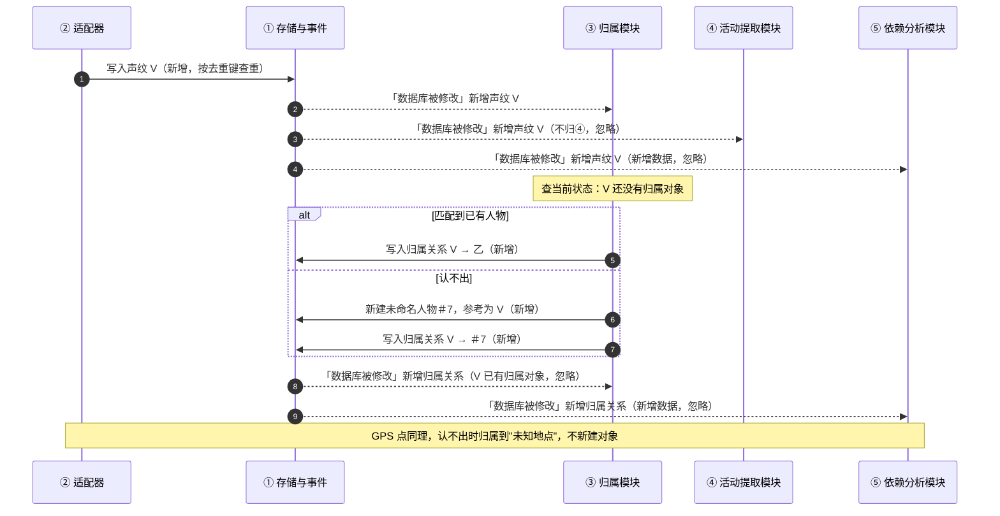
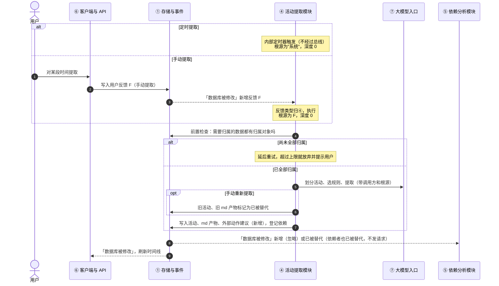
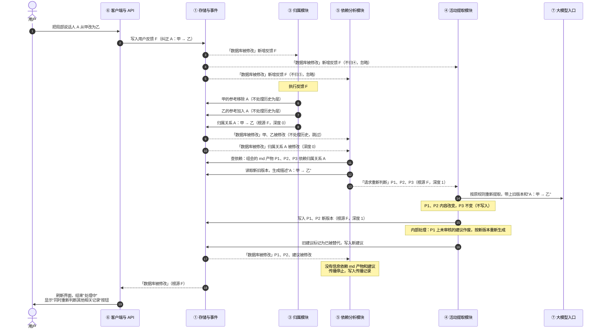
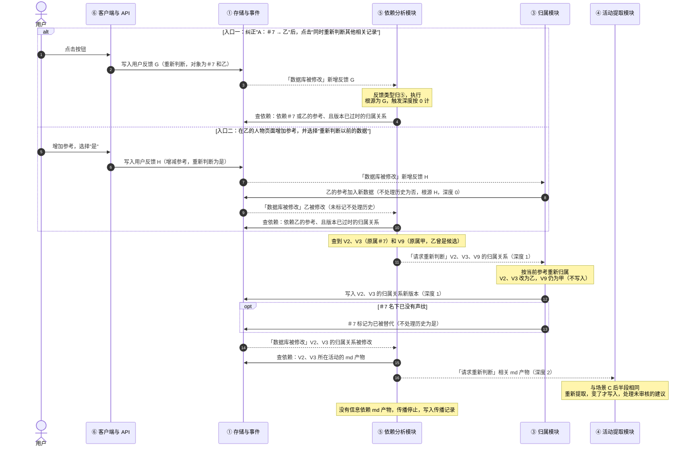
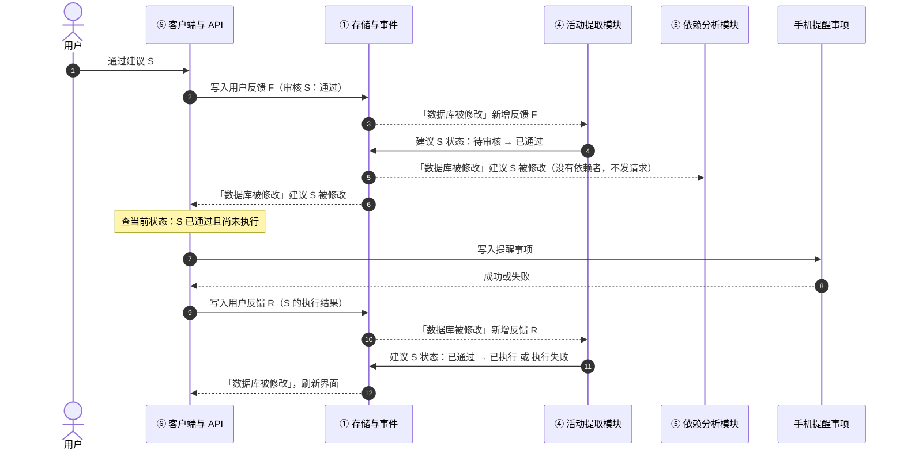

# 模块间信号（设计文档 v1.1 补充章节）

> 本节说明各模块之间怎样通信：谁发出什么信号、谁接收、收到后按什么条件处理。
> 下一版设计文档会把本节并入正文，并同步修改第 7 小节列出的相关章节。

---

## 1. 两类通信

| 类型 | 用途 | 例子 |
|---|---|---|
| **直接调用**（不经过总线） | 读写数据、调用大模型 | 任何模块写数据都调用 ①；任何模块调用大模型都经过 ⑦ |
| **总线事件** | 通知其他模块"有事要处理" | 「数据库被修改」「请求重新判断」 |

**模块之间不会直接互相下指令。** 一个模块只把数据写进 ①，由 ① 自动发出「数据库被修改」。其他模块收到后，自己判断要不要处理。

例如，⑥ 写入一条用户反馈后，③ 收到事件并执行这条反馈。整个过程中，⑥ 没有给 ③ 发过任何东西。

唯一的例外是「请求重新判断」：它由 ⑤ 主动发出，明确指定某个模块重新处理某一条数据。

---

## 2. 总线事件总表

| 事件 | 发出方 | 什么时候发 | 接收方 |
|---|---|---|---|
| 「数据库被修改」 | **只有 ①** | 写入原始数据、语义信息、归属关系、规则时自动发出；写入系统记录时不发 | ③、④、⑤、⑥；【以后】⑧ |
| 「请求重新判断」 | **只有 ⑤** | 依赖分析发现某条数据依赖的东西变了 | 按登记表分发：归属关系 → ③，md 产物 → ④ |

**不接收任何事件的模块：**
- ① 存储与事件：只发事件。
- ② 适配器：只写数据，由扫描到的新文件驱动。
- ⑦ 大模型入口：只被直接调用。

事件字段见设计文档第 4.1 节。

---

## 3. 通用处理规则

### 3.1 收到事件后

- **先查当前状态。** 事件里只有 id 和版本号，接收方要到 ① 查出数据的当前状态，再判断要不要处理。不能只凭事件内容做判断。
- **不相关的事件直接忽略。** 每个模块都会收到所有「数据库被修改」事件，只处理第 4 节列出的那些。
- **同一事件送达多次，结果和送达一次相同。** 依靠"先查当前状态"来保证。例如数据已经有归属对象，就不再处理；建议已经执行过，就不再执行。

### 3.2 根源反馈 id

- 执行用户反馈时产生的写入，根源就是这条反馈的 id。
- 系统主动发起的行为（如定时提取），根源标为"系统"。
- ⑤ 发出请求时，把根源原样传下去；负责模块按请求写入时，也原样带上。

### 3.3 依赖分析深度

- 执行用户反馈、或系统主动发起时直接产生的写入：深度为 0。
- ⑤ 发出的「请求重新判断」：深度 = 触发它的事件的深度 + 1。⑤ 执行"重新判断其他相关记录"这类反馈时，触发深度按 0 计。
- 负责模块按请求写入时，沿用请求里的深度。

### 3.4 「不处理历史」标记

这是门控机制：参考改了以后，要不要回头重新判断以前的数据，由用户决定。下表规定哪些写入带这个标记。

| 写入 | 是否标记"不处理历史" |
|---|---|
| ③ 执行纠正、确认时，参考随之变化 | 是 |
| ③ 用户增减参考，并选择"不重新判断" | 是 |
| ③ 用户增减参考，并选择"重新判断以前的数据" | 否 |
| ③ 未命名人物因名下没有声纹，被标记为已被替代 | 是 |
| 其他所有写入 | 否 |

⑤ 收到带这个标记的事件，一律跳过。

---

## 4. 各模块的处理条件

### 4.1 ③ 归属模块

| 收到 | 条件 | 做什么 |
|---|---|---|
| 「数据库被修改」 | 新增了声纹或 GPS 点，并且它还没有归属对象 | 建立归属关系 |
| 「数据库被修改」 | 新增了用户反馈，类型归 ③：纠正、确认、增减参考、新建地点、命名或改名、按时间范围重新归属 | 执行这条反馈 |
| 「请求重新判断」 | 目标是归属关系 | 按当前参考重新归属；结果变了才写入 |
| 其他 | — | 忽略 |

### 4.2 ④ 活动提取模块

| 收到 | 条件 | 做什么 |
|---|---|---|
| 「数据库被修改」 | 新增了用户反馈，类型归 ④：手动提取或重新提取、规则增删改、只改这一次的提取、把规则应用到历史活动、审核外部动作建议、外部动作的执行结果 | 执行这条反馈 |
| 「请求重新判断」 | 目标是 md 产物 | 用同一条规则，带上旧版本和修改原因重新提取；变了才写入，同时处理这条产物上未审核的建议 |
| 其他 | — | 忽略 |

④ **不直接对归属关系的修改做出反应**，一律等 ⑤ 的请求。

### 4.3 ⑤ 依赖分析模块

| 收到「数据库被修改」时 | 处理吗 |
|---|---|
| 新增数据（不是用户反馈） | 忽略：新数据还没有被任何信息依赖 |
| 新增用户反馈，类型是"重新判断其他相关记录" | **处理**：按反馈里给出的对象（纠正前后的两个对象）查依赖 |
| 新增其他类型的用户反馈 | 忽略 |
| 规则被修改 | 忽略：规则只对以后的活动生效 |
| 语义信息被修改，带"不处理历史"标记 | 忽略 |
| 语义信息被修改或标记为已被替代，不带"不处理历史"标记 | **处理**：查出依赖它、并且登记的版本已经过时的信息，只对其中的**当前版本**发出「请求重新判断」 |

### 4.4 ⑥ 客户端与 API

| 收到「数据库被修改」时 | 必需 / 可选 | 做什么 |
|---|---|---|
| 外部动作建议被修改，当前状态是"已通过"且尚未执行 | **必需** | 执行外部动作，把执行结果写成一条用户反馈 |
| 根源是自己刚提交的反馈 | 可选 | 更新"处理中"状态 |
| 其他 | 可选 | 刷新界面 |

### 4.5 【以后】⑧ 检索索引模块

| 收到「数据库被修改」时 | 做什么 |
|---|---|
| md 产物新增、修改，或标记为已被替代 | 更新这条产物的索引 |

---

## 5. 在模块内部完成、不经过总线的步骤

| 步骤 | 所在模块 | 说明 |
|---|---|---|
| 定时提取的触发 | ④ | 定时器在 ④ 内部 |
| 前置检查未通过时延后重试 | ④ | 内部重试，超过上限就放弃 |
| 纠正时同时修改参考和归属关系 | ③ | 执行一条反馈时连续写入多条数据 |
| md 产物更新后，作废未审核的旧建议并重新生成 | ④ | md 产物和建议都由 ④ 负责写 |
| 未命名人物名下没有声纹时，标记为已被替代 | ③ | 重新归属后顺带检查 |

---

## 6. 时序图

图中实线箭头表示直接调用（读写 ①、调用 ⑦）；虚线箭头表示总线事件。

### 6.1 场景 A：新数据入库

### 6.2 场景 B：定时提取与手动提取

### 6.3 场景 C：用户纠正"A 不是甲，是乙"

### 6.4 场景 D：重新判断其他相关记录

如果用户在入口二选择"不重新判断"，③ 写入参考时就带上"不处理历史"标记，⑤ 直接跳过，流程到此结束。

### 6.5 场景 E：审核并执行外部动作建议

第 7 步"查当前状态"保证：同一事件送达两次时，提醒事项不会被写入两次。

---

## 7. 对设计文档其他章节的影响

下一版设计文档（v1.2）需要同步修改：

| 位置 | 修改 |
|---|---|
| 第 5.1 节写入权限表 | ⑤ 执行一类反馈："重新判断其他相关记录" |
| 第 6.3 节门控 | 写明按钮会写入一条反馈，由 ⑤ 执行，反馈里带纠正前后的两个对象；写明"不处理历史"标记的设置规则（本节 3.4） |
| 第 8.1 节依赖分析流程 | 增加第二个入口：执行"重新判断其他相关记录"反馈；写明 ⑤ 的处理条件（本节 4.3） |
| 第 11 节用户可以做的修改 | "同时重新判断其他相关记录"的执行模块写成"⑤（再请 ③ 重新归属）" |
| 第 2.2 节数据流 | ⑥ 接收事件由"可选"改为"部分必需"（本节 4.4） |
| 工作分解 ⑤ | 工作内容增加：执行这类反馈。验收增加：点击按钮后，受影响的归属关系都能找到 |
| 工作分解 ⑥ | 按钮写入反馈时带上纠正前后的两个对象；必须监听建议变为"已通过"的事件 |
